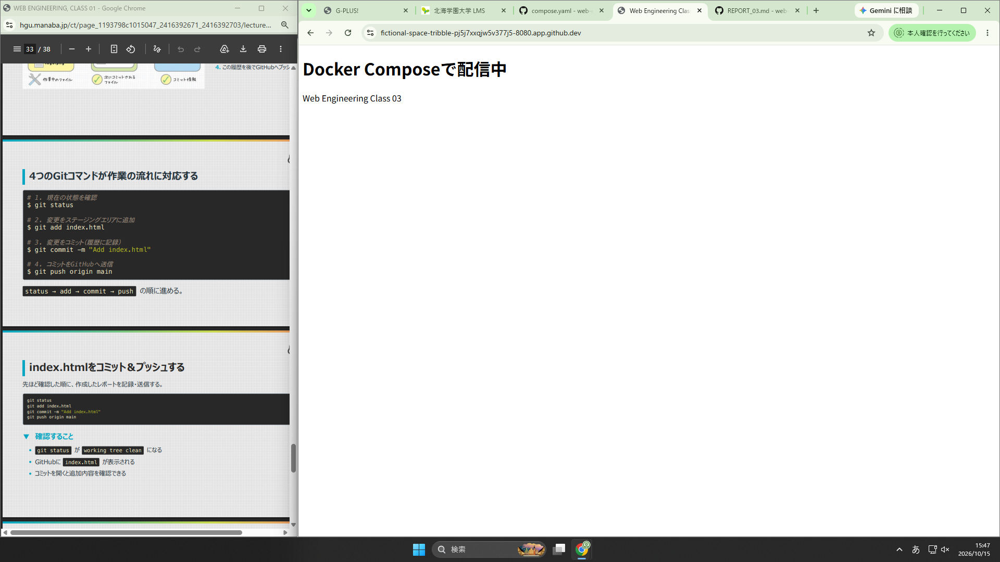

# 第3回 Webエンジニアリング演習 レポート

## 学籍番号
4724228

## イメージとコンテナの違い
イメージはアプリのファイルや実行プログラム、設定などの実行に必要なものが集まったファイル。
コンテナはイメージを元にして展開し、実際に動かしている実行中の環境のこと。
イメージを元にしているのでコンテナは削除してもイメージは残る。
大きな違いはイメージは設計図的なもので、それを元にできた実体がコンテナ。

## Dockerfileの各行の役割
FROM
Nginxと起動設定を含むコンテナの「土台」を指定する行。

COPY
ホストにあるファイルを、コンテナ内の指定したNginxの公開ディレクトリへコピーして入れる行。

## 動作確認
（変更後の見出し）
Docker Composeで配信中
Web Engineering Class 03!

（docker compose psの結果）
@4724228 ➜ /workspaces/web-eng-docker (class-03-docker) $ docker compose ps
NAME                   IMAGE                COMMAND                  SERVICE   CREATED          STATUS          PORTS
web-eng-docker-web-1   web-eng-docker-web   "/docker-entrypoint.…"   web       30 seconds ago   Up 29 seconds   0.0.0.0:8080->80/tcp, 